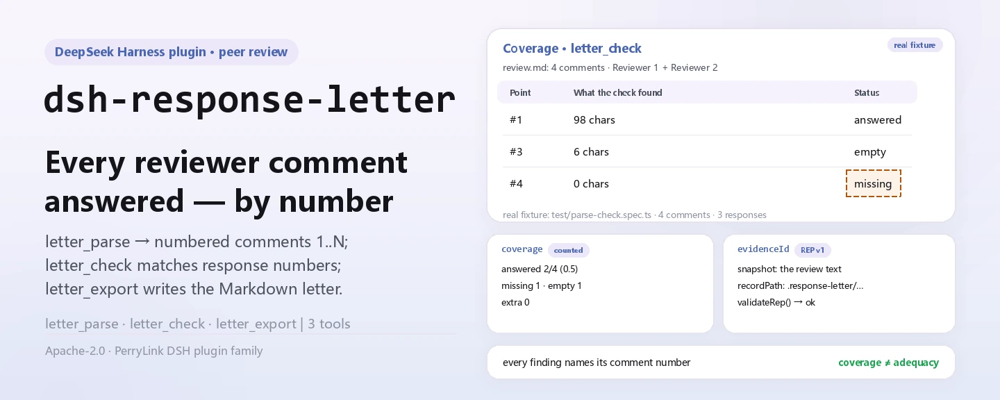
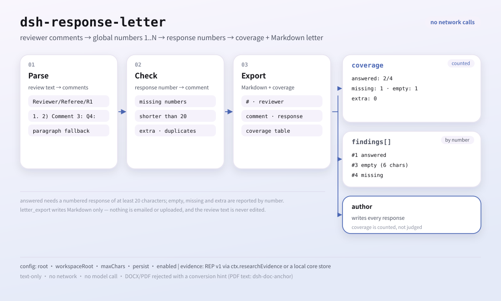
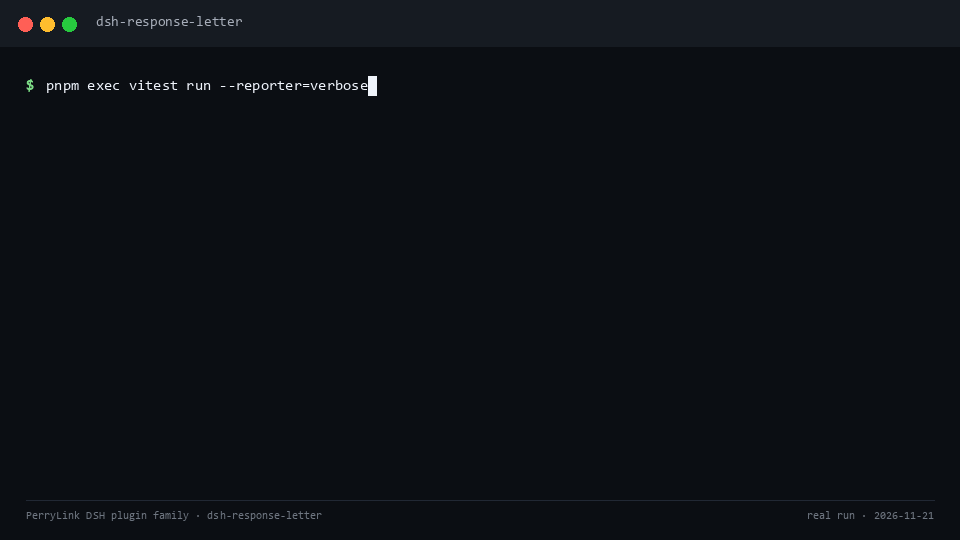

<div align="center">

<picture>
  <source media="(prefers-color-scheme: dark)" srcset="docs/assets/dsh-response-letter-hero-en-dark.webp">
  
</picture>

# dsh-response-letter

**Cada comentario del revisor, respondido — y demostrable por número.**

*Analiza los comentarios del revisor (encabezados Reviewer/Referee/审稿人, modo numerado o por párrafos), comprueba la carta punto por punto por número de respuesta (faltantes, demasiado cortas, sobrantes, duplicadas) y exporta una carta Markdown con tabla de cobertura.*

[English](README.md) · [简体中文](README-zh.md) · [Español](README-es.md) · [Português](README-pt.md) · [हिन्दी](README-hi.md)

[](LICENSE)
[]()

</div>

---

## Qué hace

- **`letter_parse`** — reconoce los encabezados `Reviewer 1`, `Referee #2`, `审稿人 2`, `R1` y los marcadores numerados (`1.`, `2)`, `Comment 3:`, `Q4:`), y asigna a cada comentario un **número global** (el número que debe citar una respuesta), una etiqueta de revisor y un localizador de caracteres. Si no hay numeración, recurre a párrafos con una advertencia explícita.
- **`letter_check`** — empareja los números de respuesta con los números de comentario e informa: números faltantes, respuestas de menos de 20 caracteres, números de respuesta duplicados y respuestas que citan un número que ningún comentario tiene.
- **`letter_export`** — una tabla Markdown (#, revisor, comentario, respuesta) con los puntos sin responder en negrita, más la tabla de cobertura. El entregable es Markdown; no se envía nada por correo ni se sube nada.


<picture>
  <source media="(prefers-color-scheme: dark)" srcset="docs/assets/dsh-response-letter-flow-v5-dark.svg">
  
</picture>

*Estructura: analizar → comprobar → exportar; `coverage` y `findings[]` son las dos salidas de la comprobación, y `letter_export` solo genera Markdown. Las etiquetas dentro del diagrama son los nombres reales de herramientas, marcadores y campos, así que la misma imagen sirve para los cinco idiomas.*

## Qué no hace

- **Sin juicio de suficiencia.** La cobertura cuenta respuestas numeradas; no dice si una respuesta es convincente, cortés o está respaldada por evidencia.
- **Sin edición del texto del revisor.** Los comentarios se reproducen tal cual; las respuestas las escribe el autor.
- **Sin DOCX/PDF.** Convierte a `.md`/`.txt` (texto de PDF: `dsh-doc-anchor`).
- **Sin envío.** No toca el sistema de la revista.
- **Sin réplicas generadas por IA.** El plugin analiza y comprueba; las palabras siguen siendo del autor.

## Cómo funciona la numeración

Los comentarios se numeran 1..N en el orden del documento y entre todos los revisores (no por revisor). La carta de respuesta debe citar los mismos números globales. Si la carta usa su propia numeración por revisor, los números no coincidirán y la comprobación lo dice en lugar de adivinar.

## Herramientas

### `letter_parse`

`{ text? | path?, persist? }` → `{ ok, parse: {comments, reviewers, mode, warnings}, evidenceId?, recordPath? }`.

### `letter_check`

`{ comments? | reviewText? | reviewPath?, letterText? | letterPath? }` → `{ ok, coverage, comments, responses, warnings }`.

### `letter_export`

`{ comments, responses? | letterText?, title? }` → `{ ok, markdown, coverage }`.

### Códigos de error

`INVALID_INPUT` · `NOT_FOUND` · `PATH_ESCAPE` · `NOT_A_FILE` · `TOO_LARGE` · `UNSUPPORTED_FILE` · `STORE_ERROR`

## Compatibilidad e instalación

| | |
|---|---|
| DeepSeek Harness | **`dsh-v0.2.2-rc.4`** (verificado 2026-11-18); peer `>=0.2.1-0 <0.3.0 \|\| >=0.2.2-0 <0.3.0` |
| Node | `^22.19.0 \|\| >=24.9.0` (probado `24.22.1`), solo ESM |
| Pares | `@perrylink/dsh-research-core ^0.1.0`, `@deepseek-ai/cordis ^4.0.5-alpha.1`, `@deepseek-ai/dsh-tools`, `@deepseek-ai/schemastery ^3.18.5-alpha.1` |
| Dependencias en tiempo de ejecución | **cero** |

```sh
dsh plugin --profile <name> add @perrylink/dsh-research-core dsh-response-letter
dsh --profile <name> --dump-config | grep dsh-response-letter
```

## Configuración

| Clave | Predeterminado | Significado |
|---|---|---|
| `enabled` | `true` | `false` no monta nada |
| `root` | `.response-letter` | raíz del almacén y de los registros |
| `workspaceRoot` | `process.cwd()` | las rutas deben resolverse dentro de ella |
| `maxChars` | `1000000` | límite de caracteres (falla, nunca trunca) |
| `persist` | `true` | guarda las revisiones analizadas como evidencia REP + registro |

## Límites de seguridad

- Solo lectura sobre los archivos de revisión y de carta; escritura solo bajo `root`.
- La contención con `realpath` rechaza escapes por enlaces simbólicos.
- El límite de caracteres falla de forma explícita; DOCX/PDF se rechazan con una pista de conversión.
- Los comentarios se tratan como datos; cualquier texto con forma de instrucción nunca se ejecuta (el plugin no tiene ejecutor).

## Evaluación



*Animado: la salida real de `pnpm exec vitest run --reporter=verbose` y la puerta del paquete (reejecutado el 2026-11-21; hoy la suite tiene 22 pruebas). El análisis y la cobertura se comprueban con fixtures explícitos; nada de esto toca la red.*


**22 pruebas**: análisis numerado con encabezados de revisor (incluido `R1`) y texto CRLF, respaldo por párrafos con advertencia, rechazo de texto vacío, extracción de respuestas, cobertura total/parcial (faltante, corta, sobrante), números duplicados y consistencia de la exportación duplicada, runtime (registro REP válido, rutas de archivo y texto, rechazo de traversal/symlink/DOCX/tamaño excesivo, cargas JSON malformadas), herramientas (esquemas, parse→check→export de extremo a extremo, rama de fallo), contrato del plugin, contrato del paquete.

No se declara ningún benchmark: la corrección aquí es el comportamiento del analizador sobre formatos explícitos, comprobado con fixtures; no existe un corpus etiquetado de cartas de respuesta reales.

## Limitaciones conocidas (v0.1)

- El analizador espera un comentario por línea/bloque numerado; un comentario que abarca varios párrafos sin numerar se divide.
- La numeración por revisor no se reasigna automáticamente; la comprobación informa del desajuste.
- La calidad de la respuesta (tono, evidencia) queda fuera del alcance.
- Solo marcadores en inglés/chino; otros idiomas necesitan patrones nuevos.

## Licencia

Apache-2.0. Ningún código de terceros en tiempo de ejecución.
