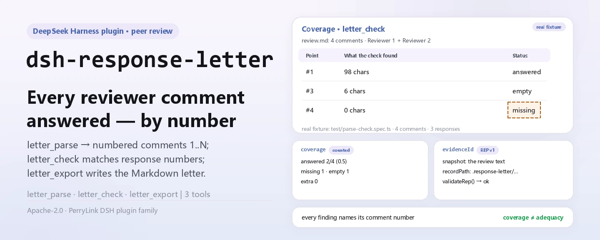
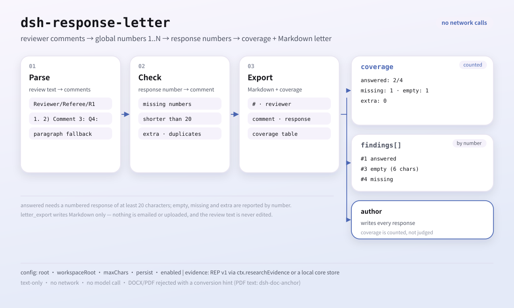
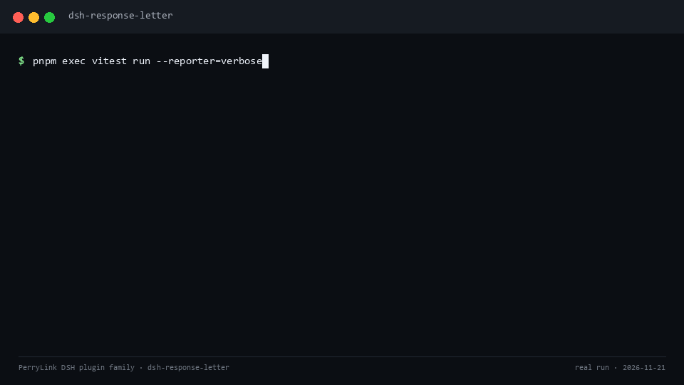

<div align="center">

<picture>
  <source media="(prefers-color-scheme: dark)" srcset="docs/assets/dsh-response-letter-hero-en-dark.webp">
  
</picture>

# dsh-response-letter

**हर रिव्यूअर कमेंट का जवाब — और नंबर से सिद्ध।**

*रिव्यूअर कमेंट्स (Reviewer/Referee/审稿人 हेडर, नंबर वाला या पैराग्राफ़ मोड) पढ़कर पॉइंट-बाय-पॉइंट लेटर को रिस्पॉन्स नंबर से जाँचता है (छूटे, बहुत छोटे, अतिरिक्त, डुप्लिकेट) और कवरेज टेबल के साथ Markdown लेटर एक्सपोर्ट करता है।*

[English](README.md) · [简体中文](README-zh.md) · [Español](README-es.md) · [Português](README-pt.md) · [हिन्दी](README-hi.md)

[](LICENSE)
[]()

</div>

---

## यह क्या करता है

- **`letter_parse`** — `Reviewer 1`, `Referee #2`, `审稿人 2`, `R1` हेडर और नंबर वाले मार्कर (`1.`, `2)`, `Comment 3:`, `Q4:`) पहचानता है और हर कमेंट को एक **ग्लोबल नंबर** (यही नंबर रिस्पॉन्स में देना होता है), रिव्यूअर लेबल और कैरेक्टर लोकेटर देता है। नंबरिंग न मिलने पर स्पष्ट चेतावनी के साथ पैराग्राफ़ मोड पर चला जाता है।
- **`letter_check`** — रिस्पॉन्स नंबरों को कमेंट नंबरों से मिलाता है और बताता है: छूटे नंबर, 20 अक्षरों से छोटी रिस्पॉन्स, डुप्लिकेट रिस्पॉन्स नंबर, और ऐसी रिस्पॉन्स जो किसी कमेंट में मौजूद ही नहीं ऐसा नंबर देती हैं।
- **`letter_export`** — Markdown टेबल (#, रिव्यूअर, कमेंट, रिस्पॉन्स), जिसमें बिना जवाब वाले पॉइंट बोल्ड होते हैं, और कवरेज टेबल भी। डिलीवरेबल Markdown है; कुछ भी ई-मेल या अपलोड नहीं होता।

<picture>
  <source media="(prefers-color-scheme: dark)" srcset="docs/assets/dsh-response-letter-flow-v5-dark.svg">
  
</picture>

*संरचना: पार्स → जाँच → एक्सपोर्ट; `coverage` और `findings[]` जाँच के दो आउटपुट हैं, और `letter_export` सिर्फ़ Markdown बनाता है। आरेख के अंदर के लेबल असली टूल, मार्कर और फ़ील्ड नाम हैं, इसलिए वही चित्र पाँचों भाषाओं के काम आता है।*

## यह क्या नहीं करता

- **पर्याप्तता का फ़ैसला नहीं।** कवरेज नंबर वाले जवाब गिनता है; यह नहीं बताता कि जवाब विश्वसनीय, विनम्र या साक्ष्य-आधारित है।
- **रिव्यूअर टेक्स्ट में बदलाव नहीं।** कमेंट्स जैसे हैं वैसे ही रखे जाते हैं; जवाब लेखक लिखता है।
- **DOCX/PDF नहीं।** `.md`/`.txt` में बदलें (PDF टेक्स्ट: `dsh-doc-anchor`)।
- **सबमिशन नहीं।** जर्नल सिस्टम को छूता ही नहीं।
- **AI से बना रिबटल नहीं।** प्लगइन सिर्फ़ पार्स और चेक करता है; शब्द लेखक के ही रहते हैं।

## नंबरिंग कैसे काम करती है

कमेंट्स दस्तावेज़ के क्रम में सभी रिव्यूअरों के बीच 1..N नंबर पाते हैं (हर रिव्यूअर के लिए अलग नहीं)। रिस्पॉन्स लेटर को वही ग्लोबल नंबर देने होते हैं। अगर लेटर अपनी अलग प्रति-रिव्यूअर नंबरिंग इस्तेमाल करता है तो नंबर मेल नहीं खाएँगे और चेक अनुमान लगाने के बजाय यही बताता है।

## टूल्स

### `letter_parse`

`{ text? | path?, persist? }` → `{ ok, parse: {comments, reviewers, mode, warnings}, evidenceId?, recordPath? }`.

### `letter_check`

`{ comments? | reviewText? | reviewPath?, letterText? | letterPath? }` → `{ ok, coverage, comments, responses, warnings }`.

### `letter_export`

`{ comments, responses? | letterText?, title? }` → `{ ok, markdown, coverage }`.

### एरर कोड

`INVALID_INPUT` · `NOT_FOUND` · `PATH_ESCAPE` · `NOT_A_FILE` · `TOO_LARGE` · `UNSUPPORTED_FILE` · `STORE_ERROR`

## संगतता और इंस्टॉल

| | |
|---|---|
| DeepSeek Harness | **`dsh-v0.2.3-alpha.1`** (2026-11-22 को सत्यापित); peer `>=0.2.1-0 <0.3.0 \|\| >=0.2.2-0 <0.3.0` |
| Node | `^22.19.0 \|\| >=24.9.0` (`24.22.1` पर टेस्टेड), केवल ESM |
| पीयर्स | `@perrylink/dsh-research-core ^0.1.0`, `@deepseek-ai/cordis ^4.0.5-alpha.1`, `@deepseek-ai/dsh-tools`, `@deepseek-ai/schemastery ^3.18.5-alpha.1` |
| रनटाइम डिपेंडेंसी | **शून्य** |

```sh
dsh plugin --profile <name> add @perrylink/dsh-research-core dsh-response-letter
dsh --profile <name> --dump-config | grep dsh-response-letter
```

## कॉन्फ़िगरेशन

| कुंजी | डिफ़ॉल्ट | अर्थ |
|---|---|---|
| `enabled` | `true` | `false` होने पर कुछ भी माउंट नहीं होता |
| `root` | `.response-letter` | स्टोर और रिकॉर्ड की जड़ |
| `workspaceRoot` | `process.cwd()` | रास्ते इसी के अंदर सुलझने चाहिए |
| `maxChars` | `1000000` | अक्षर सीमा (सीमा पार होने पर फेल, कभी काटता नहीं) |
| `persist` | `true` | पार्स किए रिव्यू को REP एविडेंस + रिकॉर्ड के रूप में सहेजता है |

## सुरक्षा सीमाएँ

- रिव्यू और लेटर फ़ाइलों पर सिर्फ़ पढ़ना; लिखना केवल `root` के अंदर।
- `realpath` के ज़रिए कंटेनमेंट सिमलिंक एस्केप को अस्वीकार करता है।
- अक्षर सीमा पार होने पर साफ़ फेल; DOCX/PDF कन्वर्ज़न संकेत के साथ अस्वीकार।
- कमेंट्स को डेटा माना जाता है; उनमें निर्देश जैसा कोई भी टेक्स्ट कभी निष्पादित नहीं होता (प्लगइन में कोई एक्ज़ीक्यूटर नहीं है)।

## मूल्यांकन



*एनिमेटेड: असली `pnpm exec vitest run --reporter=verbose` आउटपुट और पैकेज गेट (2026-11-21 को दोबारा चलाया गया; आज सूट में 22 टेस्ट हैं)। पार्सिंग और कवरेज स्पष्ट fixtures पर जाँचे जाते हैं; इसमें कुछ भी नेटवर्क को नहीं छूता।*

**22 टेस्ट**: रिव्यूअर हेडर (जिसमें `R1` भी) और CRLF टेक्स्ट के साथ नंबर वाली पार्सिंग, चेतावनी के साथ पैराग्राफ़ फ़ॉलबैक, खाली टेक्स्ट की अस्वीकृति, रिस्पॉन्स निकालना, पूरा/आंशिक कवरेज (छूटा, छोटा, अतिरिक्त), डुप्लिकेट नंबर और डुप्लिकेट एक्सपोर्ट की संगति, रनटाइम (वैध REP रिकॉर्ड, फ़ाइल और टेक्स्ट पाथ, traversal/symlink/DOCX/बहुत बड़े की अस्वीकृति, खराब JSON पेलोड), टूल्स (स्कीमा, parse→check→export एंड-टू-एंड, फ़ेल ब्रांच), प्लगइन कॉन्ट्रैक्ट, पैकेज कॉन्ट्रैक्ट।

कोई बेंचमार्क नहीं बताया गया: यहाँ शुद्धता स्पष्ट फ़ॉर्मैट पर पार्सर का व्यवहार है, जिसे fixtures से जाँचा जाता है; असली रिस्पॉन्स लेटरों का कोई लेबल किया हुआ कॉर्पस नहीं है।

## ज्ञात सीमाएँ (v0.1)

- पार्सर हर नंबर वाली पंक्ति/ब्लॉक में एक कमेंट मानता है; कई बिना नंबर वाले पैराग्राफ़ में फैला कमेंट टूट जाता है।
- प्रति-रिव्यूअर नंबरिंग अपने आप रीमैप नहीं होती; चेक बेमेल बताता है।
- रिस्पॉन्स की गुणवत्ता (लहजा, साक्ष्य) दायरे से बाहर है।
- केवल अंग्रेज़ी/चीनी मार्कर; दूसरी भाषाओं के लिए नए पैटर्न चाहिए।

## लाइसेंस

Apache-2.0. रनटाइम में कोई तृतीय-पक्ष कोड नहीं।
