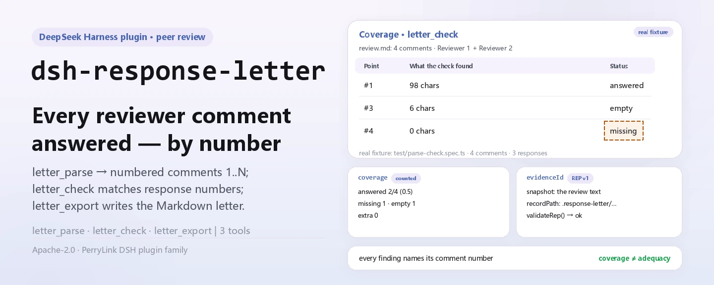
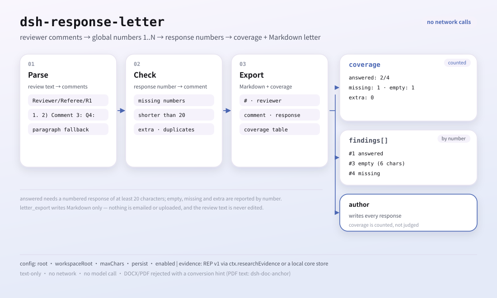
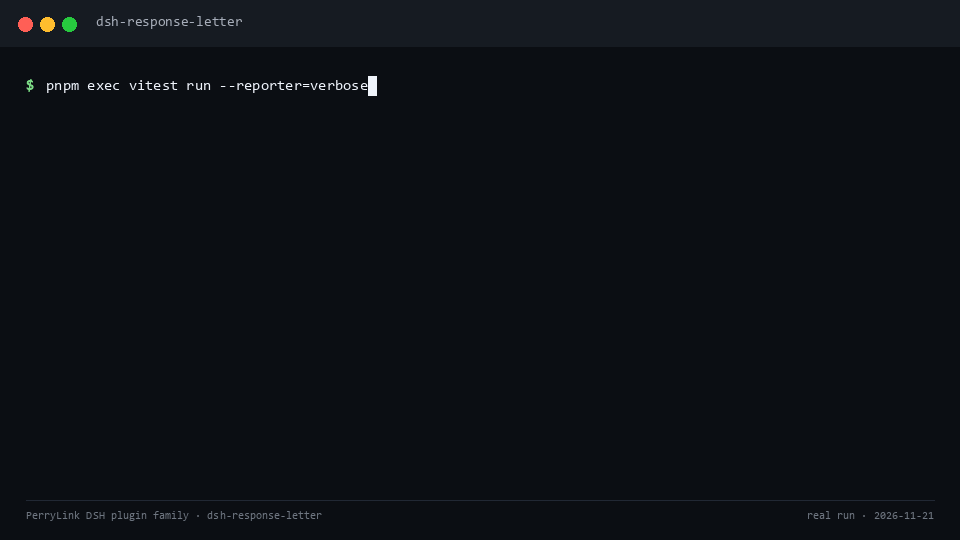

<div align="center">

<picture>
  <source media="(prefers-color-scheme: dark)" srcset="docs/assets/dsh-response-letter-hero-en-dark.webp">
  
</picture>

# dsh-response-letter

**Cada comentário do revisor respondido — e comprovável por número.**

*Analisa os comentários do revisor (cabeçalhos Reviewer/Referee/审稿人, modo numerado ou por parágrafos), verifica a carta ponto a ponto por número de resposta (faltantes, curtas demais, extras, duplicadas) e exporta uma carta Markdown com tabela de cobertura.*

[English](README.md) · [简体中文](README-zh.md) · [Español](README-es.md) · [Português](README-pt.md) · [हिन्दी](README-hi.md)

[](LICENSE)
[]()

</div>

---

## O que ele faz

- **`letter_parse`** — reconhece cabeçalhos `Reviewer 1`, `Referee #2`, `审稿人 2`, `R1` e marcadores numerados (`1.`, `2)`, `Comment 3:`, `Q4:`), atribuindo a cada comentário um **número global** (o número que uma resposta deve citar), um rótulo de revisor e um localizador de caracteres. Sem numeração, recorre a parágrafos com um aviso explícito.
- **`letter_check`** — relaciona os números das respostas com os números dos comentários e relata: números ausentes, respostas com menos de 20 caracteres, números de resposta duplicados e respostas que citam um número que nenhum comentário tem.
- **`letter_export`** — uma tabela Markdown (#, revisor, comentário, resposta) com os pontos sem resposta em negrito, mais a tabela de cobertura. O entregável é Markdown; nada é enviado por e-mail ou carregado.

<picture>
  <source media="(prefers-color-scheme: dark)" srcset="docs/assets/dsh-response-letter-flow-v5-dark.svg">
  
</picture>

*Estrutura: analisar → verificar → exportar; `coverage` e `findings[]` são as duas saídas da verificação, e `letter_export` gera apenas Markdown. Os rótulos dentro do diagrama são os nomes reais de ferramentas, marcadores e campos, então a mesma imagem serve aos cinco idiomas.*

## O que ele não faz

- **Sem julgamento de suficiência.** A cobertura conta respostas numeradas; não diz se uma resposta é convincente, educada ou baseada em evidências.
- **Sem edição do texto do revisor.** Os comentários são reproduzidos literalmente; as respostas são escritas pelo autor.
- **Sem DOCX/PDF.** Converta para `.md`/`.txt` (texto de PDF: `dsh-doc-anchor`).
- **Sem submissão.** Não toca no sistema da revista.
- **Sem réplicas geradas por IA.** O plugin analisa e verifica; as palavras continuam sendo do autor.

## Como a numeração funciona

Os comentários são numerados 1..N na ordem do documento e entre todos os revisores (não por revisor). A carta de resposta deve citar os mesmos números globais. Se a carta usar a própria numeração por revisor, os números não vão coincidir e a verificação aponta isso em vez de adivinhar.

## Ferramentas

### `letter_parse`

`{ text? | path?, persist? }` → `{ ok, parse: {comments, reviewers, mode, warnings}, evidenceId?, recordPath? }`.

### `letter_check`

`{ comments? | reviewText? | reviewPath?, letterText? | letterPath? }` → `{ ok, coverage, comments, responses, warnings }`.

### `letter_export`

`{ comments, responses? | letterText?, title? }` → `{ ok, markdown, coverage }`.

### Códigos de erro

`INVALID_INPUT` · `NOT_FOUND` · `PATH_ESCAPE` · `NOT_A_FILE` · `TOO_LARGE` · `UNSUPPORTED_FILE` · `STORE_ERROR`

## Compatibilidade e instalação

| | |
|---|---|
| DeepSeek Harness | **`dsh-v0.2.3-alpha.1`** (verificado em 2026-11-22); peer `>=0.2.1-0 <0.3.0 \|\| >=0.2.2-0 <0.3.0` |
| Node | `^22.19.0 \|\| >=24.9.0` (testado em `24.22.1`), somente ESM |
| Pares | `@perrylink/dsh-research-core ^0.1.0`, `@deepseek-ai/cordis ^4.0.5-alpha.1`, `@deepseek-ai/dsh-tools`, `@deepseek-ai/schemastery ^3.18.5-alpha.1` |
| Dependências de execução | **zero** |

```sh
dsh plugin --profile <name> add @perrylink/dsh-research-core dsh-response-letter
dsh --profile <name> --dump-config | grep dsh-response-letter
```

## Configuração

| Chave | Padrão | Significado |
|---|---|---|
| `enabled` | `true` | `false` não monta nada |
| `root` | `.response-letter` | raiz do armazenamento e dos registros |
| `workspaceRoot` | `process.cwd()` | os caminhos devem resolver dentro dele |
| `maxChars` | `1000000` | limite de caracteres (falha, nunca trunca) |
| `persist` | `true` | guarda as revisões analisadas como evidência REP + registro |

## Limites de segurança

- Somente leitura nos arquivos de revisão e de carta; escrita apenas sob `root`.
- A contenção por `realpath` rejeita escapes por links simbólicos.
- O limite de caracteres falha de forma explícita; DOCX/PDF são rejeitados com uma dica de conversão.
- Os comentários são tratados como dados; qualquer texto com forma de instrução nunca é executado (o plugin não tem executor).

## Avaliação



*Animado: a saída real de `pnpm exec vitest run --reporter=verbose` e o portão do pacote (reexecutado em 2026-11-21; hoje a suíte tem 22 testes). A análise e a cobertura são verificadas com fixtures explícitos; nada disso toca a rede.*

**22 testes**: análise numerada com cabeçalhos de revisor (incluindo `R1`) e texto CRLF, fallback por parágrafos com aviso, rejeição de texto vazio, extração de respostas, cobertura total/parcial (faltante, curta, extra), números duplicados e consistência da exportação duplicada, runtime (registro REP válido, caminhos de arquivo e texto, rejeição de traversal/symlink/DOCX/tamanho excessivo, cargas JSON malformadas), ferramentas (esquemas, parse→check→export de ponta a ponta, ramo de falha), contrato do plugin, contrato do pacote.

Nenhum benchmark é declarado: a correção aqui é o comportamento do analisador sobre formatos explícitos, verificado com fixtures; não existe um corpus rotulado de cartas de resposta reais.

## Limitações conhecidas (v0.1)

- O analisador espera um comentário por linha/bloco numerado; um comentário que abrange vários parágrafos sem numeração é dividido.
- A numeração por revisor não é remapeada automaticamente; a verificação relata a divergência.
- A qualidade da resposta (tom, evidência) está fora do escopo.
- Apenas marcadores em inglês/chinês; outros idiomas precisam de novos padrões.

## Licença

Apache-2.0. Nenhum código de terceiros em tempo de execução.
